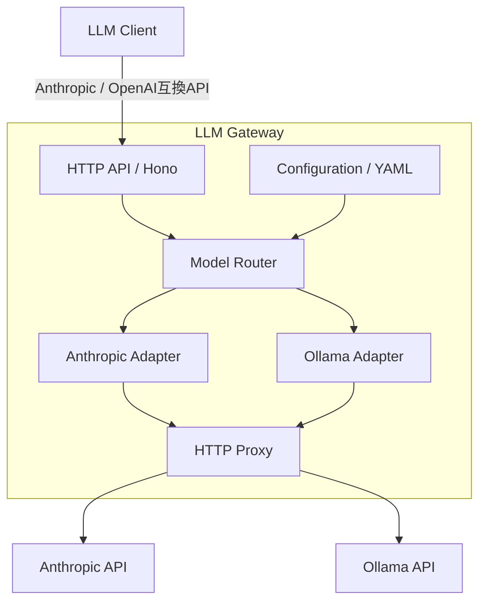

# システム構成図

## 目的

LLM Gateway の構成要素と、外部システムとの接続関係を説明する。

## 構成図

## コンポーネントの責務

| コンポーネント   | 責務                                                               |
| ---------------- | ------------------------------------------------------------------ |
| HTTP API         | リクエストの受付、バリデーション、レスポンスの返却                 |
| Configuration    | 設定ファイルの読み込み、型定義、バリデーション                     |
| Model Router     | モデルIDからProviderおよび実モデルを解決                           |
| Provider Adapter | Provider固有のリクエスト変換、認証ヘッダー制御、推論パラメータ制御 |
| HTTP Proxy       | HTTP転送、Streaming、Timeout、Cancellation                         |
| Logger           | リクエストの処理状況およびエラーの出力                             |

各コンポーネントの実装ファイルは [ディレクトリ構成](../directory.md) を参照する。
