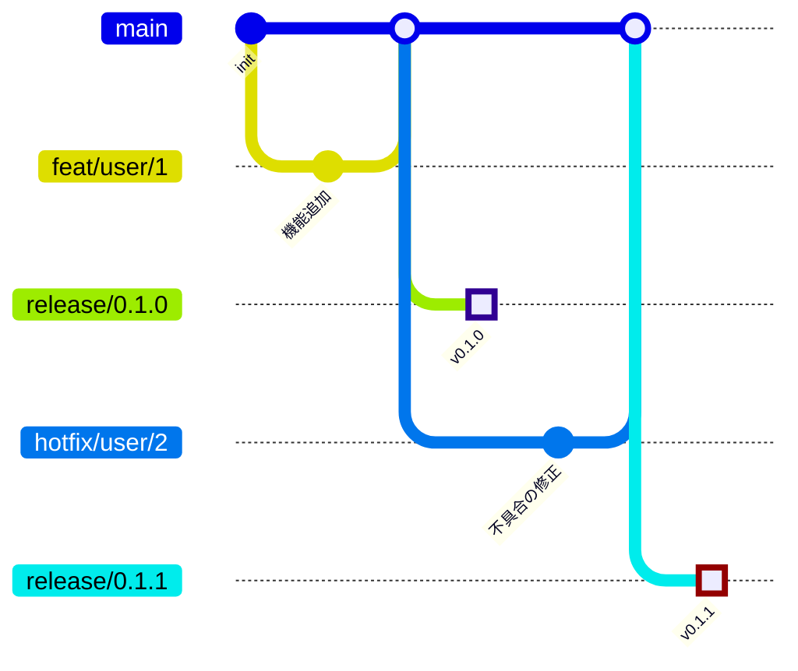

# Gitルール

## ブランチ戦略



| ブランチ                        | 用途                   | 作成元 | マージ先 |
| ------------------------------- | ---------------------- | ------ | -------- |
| `main`                          | デフォルトブランチ     | -      | -        |
| `feat/{user.name}/{issue-no}`   | 機能追加、改善         | `main` | `main`   |
| `hotfix/{user.name}/{issue-no}` | 不具合の修正           | `main` | `main`   |
| `release/{x.y.z}`               | リリースする状態の固定 | `main` | -        |

- `{user.name}`はGitHubのユーザー名にする。
- `{issue-no}`は対応するissueの番号にする。
- `{x.y.z}`はsemverにする。例: `release/0.1.0`。

## commit

- 1つのcommitには1つの目的の変更だけを入れる。
- メッセージは[Conventional Commits](https://www.conventionalcommits.org/ja/v1.0.0/)の形式にする。
  例: `feat: モデルルーティングを実装する`。
- テストが失敗する状態でcommitしない。

## PR

- PRはissue単位で作り、`main`に向ける。
- 本文に対応するissueを`Closes #N`で書く。
- マージは[レビュールール](./review.md)のレビューを終えてから行う。
- マージはsquash mergeにする。

## 依存更新のPR

| ツール     | 担当すること     | 設定                     |
| ---------- | ---------------- | ------------------------ |
| Renovate   | 通常の更新       | `renovate.json`          |
| Dependabot | セキュリティ更新 | `.github/dependabot.yml` |

- Renovateは`vulnerabilityAlerts`を無効にし、セキュリティ更新のPRを作らない。
- 自動マージは、どちらのPRも`.github/workflows/automerge.yaml`が行う。Renovateの`automerge`は使わない。

### 自動マージ

更新の種類をPRのラベルで判断する。

| ラベル                  | マージ                       |
| ----------------------- | ---------------------------- |
| `patch`、`minor`        | auto-mergeを有効にする       |
| `major`、`manual-merge` | 手動でレビューしてマージする |

- Renovateは`renovate.json`の`packageRules`でラベルを付ける。Dependabotは`automerge.yaml`が付ける。
- 0.xのminorは破壊的変更を含みうるため、`manual-merge`を付ける。
- auto-mergeを有効にしたPRは、`main`のrequired status checks(`check`、`renovate`、`actions-lock`)が成功したらマージされる。

## GitHub Actions

- workflowの`uses:`には正確なタグを書く。例: `actions/checkout@v7.0.1`。
- actionは`.github/workflows/actions.lock`でcommitに固定する。
  workflowを変えたら、lockfileを作り直してcommitする。

  ```bash
  gh extension install github/gh-actions-lock --pin v0.5.1   # 初回のみ
  gh actions-lock
  ```

- CIの`actions-lock`ジョブが、lockfileが古くないかを確認する。
- `gh-actions-lock`のバージョンは、CIと`renovate.json`の`constraints.ghActionsLock`でそろえる。

## 禁止する操作

- `main`と`release/*`へforce pushしない。
- `main`へ直接pushしない。
- 自分のブランチを作り直すときは、`git push --force-with-lease`を使う。
